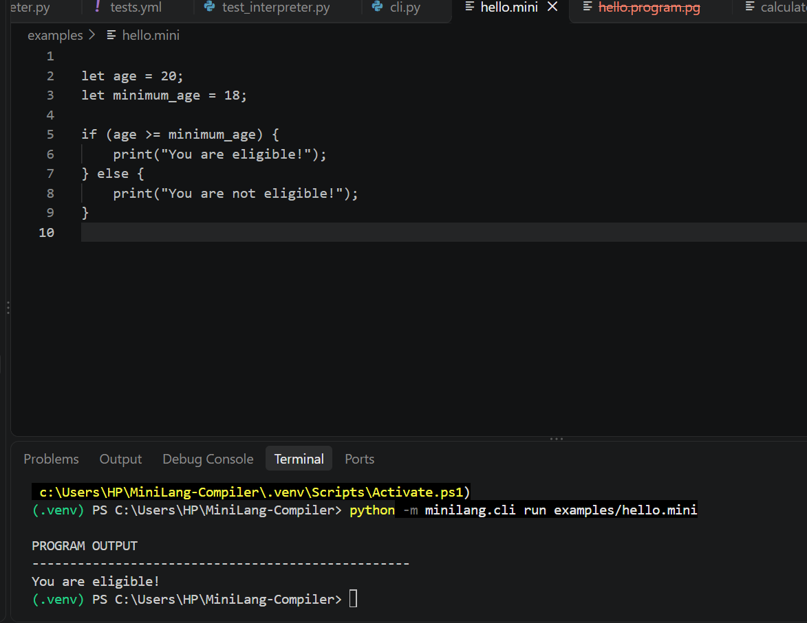

# MiniLang Compiler

**A Mini If-Else Programming Language Interpreter**

MiniLang is a custom programming language implementation developed using Python. It demonstrates the fundamental concepts of compiler design through a complete language-processing pipeline, including lexical analysis, syntax analysis, semantic analysis, Abstract Syntax Tree (AST) generation, and program interpretation.

## Project Overview

MiniLang allows users to write and execute simple programs using variables, arithmetic expressions, logical operators, and conditional statements.

This project is designed to demonstrate how programming languages process source code internally.

## Features

- Lexical Analysis (Lexer)
- Syntax Analysis (Recursive Descent Parser)
- Abstract Syntax Tree (AST)
- Semantic Analysis
- Variable declaration and assignment
- Integer, decimal, string, and Boolean values
- Arithmetic operators
- Comparison operators
- Logical operators (`and`, `or`, `not`)
- If-else conditional statements
- Nested if-else statements
- Variable scope handling
- Runtime error handling
- Command Line Interface (CLI)
- Automated testing with Pytest

## Architecture

MiniLang follows this processing pipeline:

1. **Source Code:** Reads the `.mini` program.
2. **Lexer:** Converts source code into tokens.
3. **Parser:** Validates syntax and generates an AST.
4. **Semantic Analyzer:** Checks variable declarations, scopes, and data types.
5. **Interpreter:** Executes the validated AST.
6. **CLI:** Provides commands to interact with the language.

## Technologies Used

- Python
- Object-Oriented Programming
- Recursive Descent Parsing
- Abstract Syntax Trees
- Pytest
- Visual Studio Code
- Git and GitHub

## Project Structure

```text
MiniLang-Compiler/
│
├── minilang/
│   ├── __init__.py
│   ├── tokens.py
│   ├── lexer.py
│   ├── ast_nodes.py
│   ├── parser.py
│   ├── semantic.py
│   ├── interpreter.py
│   └── cli.py
│
├── examples/
│   ├── hello.mini
│   ├── calculator.mini
│   └── logical_conditions.mini
│
├── tests/
│   ├── test_lexer.py
│   ├── test_parser.py
│   ├── test_semantic.py
│   └── test_interpreter.py
│
├── docs/
├── screenshots/
├── .github/
├── .gitignore
├── requirements-dev.txt
└── README.md
```

## Installation

Clone the repository:

```bash
git clone YOUR_GITHUB_REPOSITORY_URL
cd MiniLang-Compiler
```

Create a virtual environment:

```bash
python -m venv .venv
```

Activate it on Windows PowerShell:

```powershell
.\.venv\Scripts\Activate.ps1
```

Install development dependencies:

```bash
python -m pip install -r requirements-dev.txt
```

## Usage

Execute a MiniLang program:

```bash
python -m minilang.cli run examples/hello.mini
```

Display tokens:

```bash
python -m minilang.cli tokens examples/hello.mini
```

Display the AST:

```bash
python -m minilang.cli ast examples/hello.mini
```

Check semantic errors:

```bash
python -m minilang.cli check examples/hello.mini
```

Display CLI help:

```bash
python -m minilang.cli --help
```

## Example Program

```javascript
let age = 20;
let minimum_age = 18;

if (age >= minimum_age) {
    print("You are eligible!");
} else {
    print("You are not eligible!");
}
```

Output:

```text
You are eligible!
```

## Automated Testing

Run the test suite:

```bash
python -m pytest -v
```

**Current verified test results: 60 passed.**

## Project Developer

- Ravi Kumar — CSC-24S-013

## Project Purpose

This project was developed as part of the Compiler Construction course to demonstrate practical understanding of programming language design, compiler architecture, parsing techniques, semantic validation, and interpretation.

---

**MiniLang Compiler — Built with Python.**

## Screenshots

### Hello World Program

This example demonstrates variable declaration, conditional statements, and program execution in MiniLang.


