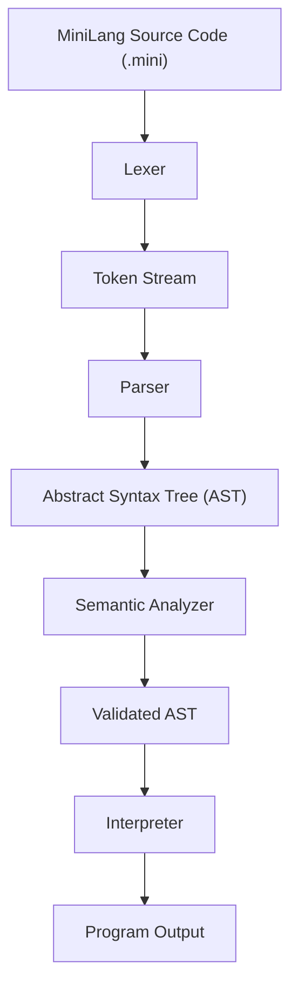

# MiniLang Compiler – System Architecture

## 1. Overview

MiniLang processes source code through a sequence of compiler components. Each component performs a specific task before the program is executed.

## 2. Architecture Diagram



## 3. Component Responsibilities

### Lexer
Reads source code and converts it into tokens.

### Parser
Checks grammatical structure and generates the AST using recursive descent parsing.

### Abstract Syntax Tree
Represents the structure of the program using nodes such as declarations, expressions, assignments, and conditional statements.

### Semantic Analyzer
Checks variable declarations, scope rules, and data type compatibility.

### Interpreter
Evaluates expressions and executes statements.

### Command Line Interface
Provides commands for running programs, displaying tokens, viewing AST, and checking semantic errors.

## 4. Processing Example

Input:

```javascript
let age = 20;

if (age >= 18) {
    print("Eligible");
}
```

Processing:

1. Lexer identifies keywords, identifiers, operators, and literals.
2. Parser creates the AST.
3. Semantic Analyzer validates the program.
4. Interpreter evaluates the condition.
5. CLI displays the output.

Expected output:

```text
Eligible
```

## 5. Architecture Summary

MiniLang uses a modular architecture in which each component has a separate responsibility. This makes the implementation easier to maintain, test, and extend.
```
